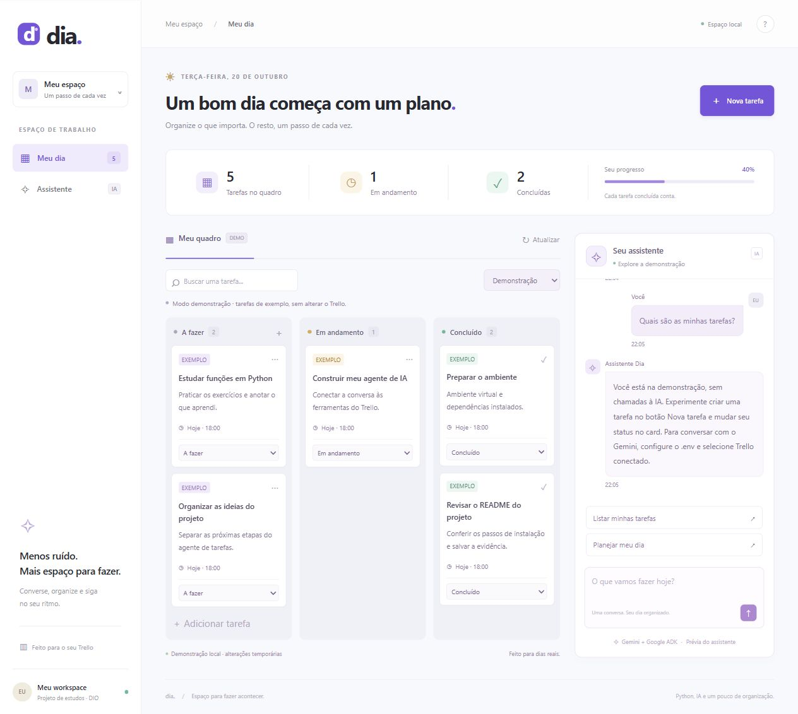

# Agente de tarefas no Trello

Projeto do desafio DIO: organizar as tarefas do dia por conversa, usando Python,
Google Agent Development Kit (ADK), Gemini e py-trello.

Agora inclui **Dia**, uma interface própria com quadro Kanban, conversa com o
agente, busca, formulário de criação, progresso e movimentação dos cards.
HTML, CSS e JavaScript são servidos pelo mesmo backend Python, sem precisar
instalar Node.js ou executar um build.



O print acima mostra a demonstração local. Ele não é uma evidência de acesso
ao Gemini ou ao seu Trello real. Há também uma
[captura em tela de celular](docs/interface-mobile.png).

O agente informa a data atual e pergunta pelas tarefas na primeira resposta.
Cada tarefa vira um card com título, descrição e vencimento na lista **A fazer**.
Ao conversar, você pode consultar as tarefas e movê-las para **Em andamento** ou
**Concluído**. O ADK Web responde depois da primeira mensagem; envie “Olá” para
iniciar a conversa.

## Ferramentas e organização

| Função | O que faz |
| --- | --- |
| `obter_data_atual` | Retorna a data no fuso configurado. |
| `criar_tarefa` | Cria um card em A fazer, com descrição e vencimento às 18h. |
| `listar_tarefas` | Lista cards ativos de todos os status ou de uma lista. |
| `mover_tarefa` | Move um card pelo ID para um dos três status. |

```text
agente-tarefas-trello/
├── task_agent/
│   ├── __init__.py
│   ├── agent.py
│   └── tools.py
├── tests/
│   ├── test_tools.py
│   └── test_webapp.py
├── frontend/
│   ├── index.html
│   ├── style.css
│   ├── app.js
│   └── favicon.svg
├── docs/
│   ├── interface-desktop.png
│   └── interface-mobile.png
├── webapp.py
├── Iniciar interface.cmd
├── .env.exemplo
├── .gitignore
├── requirements.txt
└── README.md
```

Em `agent.py`, `root_agent` registra as funções como ferramentas. O Gemini lê
as instruções, os nomes, as descrições e os argumentos das funções para escolher
qual chamar. `tools.py` valida os dados e executa a ação no Trello. O resultado
volta como um dicionário com `ok`, e o agente transforma esse retorno em uma
resposta na conversa. A data das instruções é recalculada a cada interação.

## 1. Preparar o Trello

1. Crie um quadro chamado **DIO**, ou escolha outro nome e ajuste o `.env`.
2. Crie as listas **A fazer**, **Em andamento** e **Concluído**.
3. Acesse o [portal de Power-Ups](https://trello.com/power-ups/admin/) e registre
   um aplicativo na sua área de trabalho.
4. Na área de chave de API do aplicativo, obtenha a chave e o segredo.
5. Use a opção de gerar token da página ou abra o endereço abaixo, substituindo
   `SUA_CHAVE` pela sua chave. Autorize leitura e escrita e guarde o token.

```text
https://trello.com/1/authorize?expiration=30days&name=AgenteTarefas&scope=read,write&response_type=token&key=SUA_CHAVE
```

O token deste exemplo expira em 30 dias; renove quando necessário. O fluxo de
token pessoal usa chave e token; o segredo é opcional neste código, mas há campo
para ele no arquivo de configuração. Consulte o
[guia base da DIO](https://github.com/digitalinnovationone/agent-carbon-footprint/blob/main/agents/agent04/readme.md)
e a [autorização oficial do Trello](https://developer.atlassian.com/cloud/trello/guides/rest-api/authorization/).

O quadro padrão é DIO. Para outro quadro, altere `TRELLO_BOARD_NAME`. Se houver
nomes repetidos, preencha `TRELLO_BOARD_ID` com o ID do quadro: ele tem prioridade.
O agente usa somente o quadro configurado e seus cards ativos nas três listas.
As listas devem ter nomes distintos; listas extras são ignoradas.

## 2. Instalar e configurar

Use Python **3.10 ou superior**. Este projeto fixa `google-adk==1.18.0`, da linha
1.x, para preservar a compatibilidade com o desafio. Versões mais novas do ADK
podem exigir outro Python e mudanças no código. Python 3.12 é uma boa opção para
reproduzir este ambiente. Confira a instalação com `python --version`.

Abra um terminal PowerShell **nesta pasta** e execute:

```powershell
python -m venv .venv
.\.venv\Scripts\python.exe -m pip install -r requirements.txt
Copy-Item .env.exemplo .env
```

Não é necessário ativar o ambiente virtual. Em Linux/macOS, use `python3` para
criá-lo, `.venv/bin/python` nos comandos seguintes e `cp .env.exemplo .env`.

Crie uma chave no [Google AI Studio](https://aistudio.google.com/apikey). Edite
o `.env` local e preencha `GOOGLE_API_KEY`, `TRELLO_API_KEY`, `TRELLO_TOKEN` e,
se desejar, `TRELLO_API_SECRET`. Ajuste o nome do quadro. Não envie esses valores
em conversas, prints ou commits.

`GEMINI_MODEL` pode ser alterado para um modelo Gemini disponível na sua conta
com suporte a chamadas de ferramentas. O exemplo usa `gemini-2.5-flash`;
disponibilidade e cotas dependem da conta. Confira o
[catálogo oficial](https://ai.google.dev/gemini-api/docs/models) se receber erro
de modelo indisponível. `GOOGLE_GENAI_USE_VERTEXAI=FALSE` seleciona a API por chave.

O arquivo `.env` é carregado pelo caminho do projeto, sem substituir variáveis
já definidas no terminal. O exemplo usa `APP_TIMEZONE=America/Sao_Paulo`.
`tzdata` fornece a base de fusos também no Windows. `datetime` faz parte do
Python e não precisa ser instalado separadamente.

O pacote do agente já está criado: não é necessário executar `adk create`.

## 3. Rodar e conversar

### Interface própria — Dia

Depois de instalar as dependências, dê dois cliques em **Iniciar interface.cmd**
e abra [http://127.0.0.1:8765](http://127.0.0.1:8765). Mantenha a janela do
terminal aberta durante o uso. Para encerrar, pressione Ctrl+C nela.

Você também pode executar nesta pasta:

```powershell
.\.venv\Scripts\python.exe -m uvicorn webapp:app --host 127.0.0.1 --port 8765
```

A interface oferece:

- **Nova tarefa:** cria um card em A fazer com título, descrição e data.
- **Status:** use o seletor do card ou arraste entre as três colunas.
- **Busca:** filtra por título e descrição, aceitando termos sem acentos.
- **Resumo:** total, quantidade em andamento, concluídas e percentual concluído.
- **Chat:** envia as mensagens ao mesmo agente ADK e atualiza o quadro depois
  da resposta. Enter envia; Shift+Enter insere uma nova linha.
- **Atualizar:** busca novamente os cards, incluindo mudanças feitas no Trello.

Sem credenciais do Trello, o modo inicial é **Demonstração**. Os cards de exemplo
permitem testar criação e movimentação sem chamadas externas. O chat informa
que a IA está desligada nesse modo. Os dados de demonstração ficam na memória
do servidor, são compartilhados entre as abas locais e voltam aos exemplos
iniciais quando o servidor é reiniciado.

Para usar o quadro real, configure o `.env`, reinicie e selecione **Trello
conectado**. O chat também exige `GOOGLE_API_KEY`; criar ou mover pelo formulário
usa somente o Trello. A presença das chaves não garante que sejam válidas: erros
de conexão aparecem na própria interface. Nunca insira chaves no chat.

O frontend chama os endpoints `/api/config`, `/api/tasks` e `/api/chat` de
`webapp.py`. As credenciais permanecem no Python. O backend usa as ferramentas
existentes para as operações e um `Runner` ADK para a conversa. O histórico do
agente é separado por sessão do navegador e fica na memória enquanto o servidor
está ligado. Os cards reais continuam armazenados no Trello.

Os indicadores incluem todos os cards das três listas, de qualquer data. A busca
filtra apenas a visualização; não altera o total do resumo. Em celulares, o quadro
tem rolagem horizontal própria e o chat aparece abaixo dele.

Esta aplicação foi preparada para uso local por uma pessoa. Não inclui login
ou isolamento entre usuários para hospedagem pública. O ADK Web continua
disponível como alternativa para os testes do desafio.

### Interface de desenvolvimento — ADK Web

Ainda nesta pasta, execute:

```powershell
.\.venv\Scripts\adk.exe web --no-reload --host 127.0.0.1 --port 8000 .
```

Abra [http://127.0.0.1:8000](http://127.0.0.1:8000), selecione `task_agent` e envie
“Olá”. Em Linux/macOS, o executável é `.venv/bin/adk`.
O comando desativa o recarregamento automático; reinicie o servidor ao editar
o código. Isso também evita a varredura da pasta do ambiente virtual.

Exemplo de roteiro para **você executar**, informando a descrição na criação:

```text
Olá!
Crie a tarefa Estudar Python para hoje, com a descrição Praticar funções.
Liste todas as tarefas.
Comecei a tarefa Estudar Python.
Liste as tarefas em andamento.
Terminei a tarefa Estudar Python. Mova para concluído.
Liste as tarefas concluídas.
```

Confira cada mudança no quadro. A ferramenta de criação aceita descrição;
esta versão não edita descrições depois da criação. Se dois cards tiverem o
mesmo nome, o agente deve apresentar os candidatos antes de mover.
Não há ferramenta de exclusão ou arquivamento.

## Melhoria principal: corrigir o dia do vencimento

Enviar uma data sem fuso pode fazer a interface mostrar o dia anterior ao
interpretar o instante em um fuso diferente. Aqui a data `AAAA-MM-DD` é combinada
com **18h no fuso local**, convertida para UTC e enviada com o sufixo `Z`.
Na listagem, o vencimento é convertido de volta ao fuso configurado.

Por exemplo, `2026-10-20` em São Paulo é enviado como
`2026-10-20T21:00:00Z`, equivalente a **20/10/2026 às 18h**. O Trello exibe o
instante conforme o fuso do usuário; para conferir o mesmo dia e horário,
use no Trello o mesmo fuso configurado no agente. Esta versão trabalha com
datas e horário fixo às 18h, sem seleção de horário por tarefa.

Também foram incluídos normalização de acentos e maiúsculas nos status,
conexão centralizada e retorno de erro em todas as ferramentas. Falhas HTTP
não são exibidas integralmente, pois podem conter credenciais. Após uma falha
em uma escrita, consulte o quadro antes de repetir para evitar duplicidade.

## Testes e evidências

Execute os testes sem usar Gemini ou Trello:

```powershell
.\.venv\Scripts\python.exe -m unittest discover -s tests -v
```

Os testes simulam a fronteira com o Trello e verificam criação com descrição e
UTC, conversão de volta ao dia local, mudança de dia UTC em outro fuso, datas
inválidas, status com e sem acento, listagem com filtro, movimentação por ID,
restrição ao quadro, configuração incompleta e erros sem vazamento de token.
Eles também verificam a atualização da data usada nas instruções.

Validação local realizada com Python 3.12.14 e ADK 1.18.0: **44 testes Python
aprovados**, incluindo a geração dos esquemas das ferramentas pelo ADK.
`pip check` também passou, sem dependências incompatíveis.
O ADK Web foi iniciado em localhost e o endpoint `/list-apps` retornou
`task_agent`. O servidor foi encerrado depois dessa verificação.

Os testes HTTP da interface verificam criação e movimentação na demonstração,
integração das rotas com as ferramentas, continuidade de sessão do chat, erros,
proteção contra acesso ao `.env` e ausência de credenciais nas respostas.
O Gemini é simulado nesses testes, sem gastar cota.

No navegador, foram conferidos criação pelo formulário, mudança para Concluído,
atualização dos indicadores, busca sem acento e resposta explícita do chat de
demonstração. O layout foi inspecionado em desktop e em 390 × 844 pixels,
sem transbordamento horizontal da página. As capturas estão na pasta `docs`.

Uma rodada ampliada acrescentou **16 testes JavaScript**, totalizando **60
testes automatizados aprovados**. Foram corrigidos 11 problemas encontrados
nos testes. A suíte cobre também respostas atrasadas, cliques repetidos,
recuperação de falhas, limites de texto, segurança básica e concorrência.
Confira os casos, as correções, as evidências e as limitações no
[relatório de testes](docs/RELATORIO-TESTES.md).

Para executar os testes JavaScript, use Node.js 20 ou superior e pnpm:

```powershell
pnpm install --frozen-lockfile --ignore-scripts
pnpm test
```

Node.js e pnpm são opcionais para desenvolvimento e testes do frontend. A
aplicação continua rodando somente com Python. Após falha na inicialização,
use Atualizar para tentar novamente. A data local também é atualizada ao
sincronizar o quadro. O chat continua funcionando se o armazenamento do navegador
estiver bloqueado, mas sem garantir continuidade da sessão entre as mensagens.

**Testes locais não comprovam integração real.** A validação com suas contas
fica pendente até você configurar o `.env` e executar o roteiro no ADK Web.
As capturas incluídas são somente da demonstração da interface própria.

Antes da entrega, valide e registre:

- [ ] A saudação mostra a data local correta.
- [ ] Um pedido cria um card com nome, descrição e data correta no Trello.
- [ ] A listagem geral e por status corresponde ao quadro.
- [ ] O card passa por A fazer → Em andamento → Concluído.
- [ ] “Concluído” e “concluido” são aceitos.
- [ ] Um print mostra a conversa no ADK Web ao lado do quadro, sem segredos.

Salve seu print, por exemplo em `docs/evidencia.png`, e só então inclua o link
no README. Descreva a data do teste, o pedido enviado e o resultado observado.

Se ocorrer erro 429, confira a cota do Gemini no AI Studio e aguarde a renovação
indicada. Erros de acesso ao Trello pedem conferência do token, validade,
permissões e acesso ao quadro. Reinicie o ADK após alterar o `.env`.

## Publicar para entregar

Este projeto está na raiz do seu próprio repositório Git, separado do ContaVoz.
Não copie a pasta `.git` de outro projeto nem crie um segundo repositório
dentro deste. Execute os comandos de publicação nesta pasta.

No GitHub, crie um repositório público com nome como `agente-tarefas-trello`.
Na pasta copiada, execute, substituindo `SEU_USUARIO`:

```powershell
git init
git add .
git status --short
git diff --cached
# Confira o conteúdo antes de continuar: nenhuma credencial deve aparecer.
git commit -m "Adiciona agente de tarefas com ADK e Trello"
git branch -M main
git remote add origin https://github.com/SEU_USUARIO/agente-tarefas-trello.git
git push -u origin main
```

Envie o link da raiz desse repositório público. Confira que `.env` e `.venv`
estão ignorados e que os arquivos descritos acima foram enviados. Se publicar
uma credencial por engano, revogue-a e gere outra; apagar o arquivo do último
commit não remove o segredo do histórico.

## Referências

- [Desafio e repositório base da DIO](https://github.com/digitalinnovationone/agent-carbon-footprint/tree/main/agents/agent04).
- [ADK 1.18.0 usado neste projeto](https://pypi.org/project/google-adk/1.18.0/).
- [Documentação do ADK](https://google.github.io/adk-docs/get-started/python/).
- [py-trello](https://github.com/sarumont/py-trello).
- [API de cards do Trello](https://developer.atlassian.com/cloud/trello/rest/api-group-cards/).

Implementação própria baseada nos requisitos do desafio; não é uma cópia
integral do agente original. O código foi separado em instruções e ferramentas
para facilitar o estudo e os testes.
