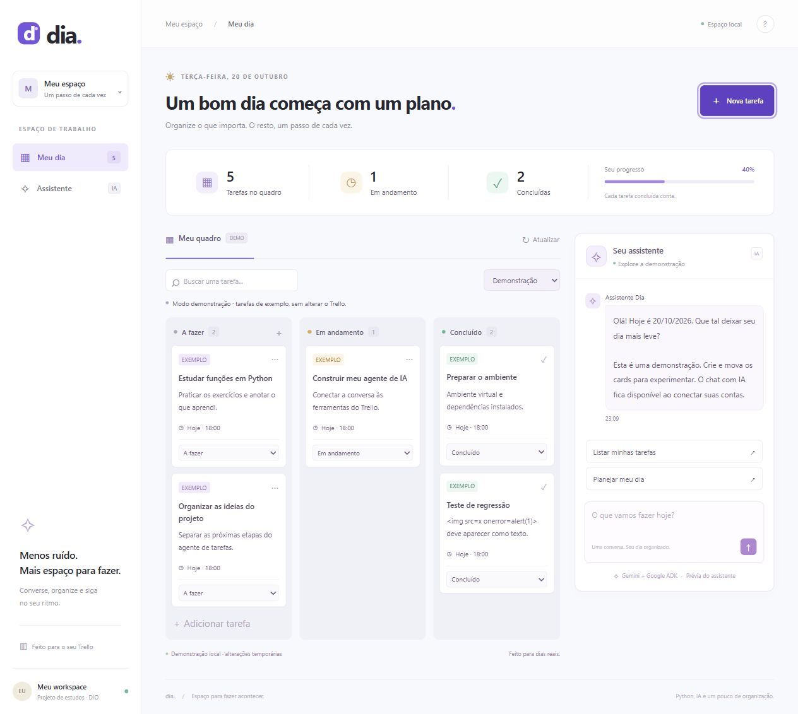

# Relatório de testes — Dia

Rodada de validação local em 20/10/2026. Resultado: **60 testes automatizados
aprovados**, sendo **44 Python** e **16 JavaScript**, além da verificação manual
no navegador. Foram reproduzidos e corrigidos **11 problemas**.

## O que foi verificado

| Tipo | Cobertura | Resultado |
| --- | --- | --- |
| Ferramentas e regras | Criação, listagem, filtros, status, IDs e registro das ferramentas no ADK | Aprovado |
| Datas | 250 conversões em cinco fusos, incluindo mudança de dia em UTC; datas inválidas e virada do dia no front | Aprovado |
| API HTTP | Rotas, métodos, validação, campos obrigatórios, limites, Unicode e JSON malformado | Aprovado |
| Concorrência | 40 criações simultâneas; nenhum ID repetido ou registro perdido | Aprovado |
| Respostas atrasadas | Resposta antiga não substitui o quadro após trocar de modo | Aprovado |
| Envios repetidos | Duplo envio de formulário e mensagens repetidas enquanto a resposta está pendente | Uma solicitação por operação |
| Falhas de serviços | Erros do Trello, sessão indisponível, ausência de chaves e falhas de rede no front | Erros tratados sem expor segredos |
| Segurança básica | HTML/script como texto, links restritos, origem e Host, leitura indevida do .env e caminhos codificados | Aprovado nos casos testados |
| Acessibilidade | Nomes dos diálogos, Escape, foco no campo obrigatório, Shift+Enter e entrada em composição | Aprovado nos casos testados |
| Contraste | Nove seletores de textos principais, comparados com seus fundos previstos no CSS | Pelo menos 4,5:1 nos seletores testados |
| Responsividade | Larguras 320, 390, 768 e 1440 pixels | Sem transbordamento horizontal da página |
| Dependências e sintaxe | pip check, compilação Python e node --check | Aprovado |

As 250 conversões e as 40 criações são cenários dentro dos 60 testes, não testes
extras somados ao total. Os fusos foram America/Sao_Paulo,
America/Los_Angeles, Pacific/Kiritimati, Asia/Kolkata e Europe/Lisbon.

## Problemas reproduzidos e corrigidos

| # | Problema antes da correção | Correção |
| --- | --- | --- |
| 1 | Falhas de conexão apareciam como “Failed to fetch” | Mensagem compreensível em português |
| 2 | Após falhar a configuração inicial, Atualizar não recuperava a interface | Nova tentativa de inicialização e reativação dos controles |
| 3 | A página mantinha a data anterior depois de virar o dia | Atualização da data ao sincronizar o quadro |
| 4 | Abrir Nova tarefa durante um salvamento apagava o conteúdo do formulário | Bloqueio da abertura enquanto a operação está em andamento |
| 5 | Armazenamento do navegador bloqueado impedia o envio ao chat | Leitura e escrita de sessão tolerantes à indisponibilidade; sessão inválida é ignorada |
| 6 | Diálogos sem nome acessível | Associação dos diálogos aos seus títulos |
| 7 | Chamadas HTTP ao Trello podiam esperar indefinidamente | Limites de 5s para conexão e 20s para leitura, sem repetição automática de escrita |
| 8 | O ADK executava funções síncronas no loop, bloqueando outras requisições | Ferramentas registradas com execução em thread |
| 9 | Fuso incorreto derrubava o servidor durante a criação dos exemplos | Inicialização tolerante ao erro; a configuração responde com orientação e status 503 |
| 10 | Falha ao consultar ou criar sessão escapava do tratamento do chat | Resposta controlada com status 502 e sem detalhes internos |
| 11 | Textos relevantes tinham contraste insuficiente | Escurecimento dos textos principais do quadro e da conversa |

Os testes JavaScript inicialmente reproduziram seis falhas. Os novos testes
Python reproduziram quatro falhas adicionais. A verificação de contraste
reproduziu o último problema. Depois das correções, as suítes passaram.

Os tempos do transporte HTTP são limites de conexão e de espera por leitura,
não uma garantia de duração máxima para uma operação com várias requisições.
O chat mantém seu limite de 90s para a execução do agente. Uma escrita em thread
que já tenha começado pode terminar depois de um cancelamento; confira o quadro
antes de repetir, conforme a mensagem de erro orienta.

## Conferência no navegador

Foi iniciado um servidor de teste em localhost:8765 com Trello e Gemini
desativados no ambiente do processo. O arquivo .env não foi alterado para isso.

1. O formulário vazio permaneceu aberto, levou o foco ao nome e não criou card.
2. A tarefa “Teste de regressão” foi criada com descrição contendo uma tag HTML
   e um manipulador de evento como texto. Nenhum elemento img ou script foi
   criado dentro dos cards.
3. O card foi movido para Concluído pelo seletor. O resumo mostrou cinco cards,
   dois concluídos e 40% de progresso.
4. Trello conectado sem chaves mostrou uma mensagem de configuração. Voltar
   à demonstração recuperou os cards e removeu o erro.
5. Escape fechou o diálogo e devolveu o foco ao botão Nova tarefa.
6. As quatro larguras foram conferidas. O console capturado pelo navegador não
   registrou erros ou avisos nessa rodada.



[Captura em celular](qa-mobile.png).

## Reproduzir

Na raiz do projeto, com as dependências Python instaladas:

```powershell
.\.venv\Scripts\python.exe -m unittest discover -s tests -v
.\.venv\Scripts\python.exe -m pip check
```

Para os testes do frontend, instale Node.js 20 ou superior e pnpm. Eles são
necessários somente para esta suíte de desenvolvimento, não para usar a aplicação:

```powershell
pnpm install --frozen-lockfile --ignore-scripts
pnpm test
node --check frontend/app.js
```

`tests/frontend.test.cjs` usa jsdom para executar o JavaScript contra um DOM
simulado. Os testes Python usam unittest, TestClient, httpx e mocks. Todas as
chamadas ao Gemini e ao Trello são simuladas nos testes automatizados.

## Limitações

- Ainda falta testar a autenticação e as operações com contas reais do Trello
  e Gemini. Não foram gastos créditos nem criada evidência falsa dessa integração.
- A comparação de contraste cobre os seletores listados no teste; não é uma
  auditoria completa de acessibilidade. Não houve teste com leitor de tela.
- A rodada manual usou o navegador integrado em um computador; não equivale a
  testar Safari, Firefox e aparelhos físicos. A movimentação foi conferida pelo
  seletor de status, sem automação de gestos de arrastar em dispositivos touch.
- Quarenta requisições locais não constituem teste de capacidade de produção.
  A aplicação continua voltada ao uso local por uma pessoa.
- pip check verifica compatibilidade das dependências, não vulnerabilidades
  publicadas. Não foi executada uma auditoria completa de segurança das dependências.
- O ADK/Vertex emite avisos de depreciação e inferência de nome do app neste
  ambiente; eles não impediram a execução dos testes.
